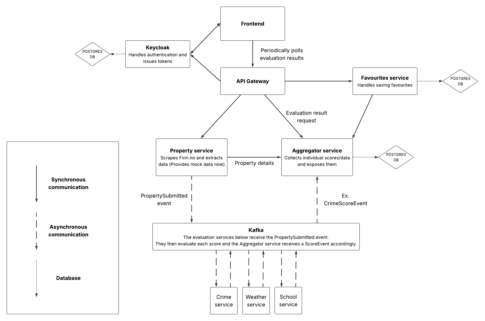

### EstateRate

EstateRate is a property evaluation tool designed to help homebuyers assess and compare the attractiveness of different living locations in Oslo.

### Project Overview

By submitting a property listing URL from Finn.no, EstateRate extracts property and location data and evaluates the surrounding area based on factors such as crime rates, nearby schools, and historical weather conditions. 
Each evaluation factor is handled by a dedicated microservice that gathers and processes relevant data. Evaluations are performed asynchronously using Kafka, allowing individual services to process property data independently. 
Once processed, the frontend presents both the individual factor scores and a dynamically calculated overall score. 
Users can customize the evaluation by excluding factors that are not relevant to them, causing the overall score to recalculate immediately based on their preferences.
EstateRate also allows users to compare evaluated properties side by side, and registered users can save properties as favorites to revisit their evaluations later. 
From a technical standpoint, the application demonstrates both synchronous REST communication and asynchronous event-driven messaging via Kafka, alongside service discovery with Consul.

### System Architecture



### User Stories

* **Evaluate Locations:** As a property buyer, I want to submit a Finn.no property listing so that I can evaluate the attractiveness of the property's location before making a purchase decision.
* **Customize Preferences:** As a property buyer, I want to customize which factors are included in the evaluation so that the overall score reflects my preferences.
* **Compare Properties:** As a property buyer, I want to compare property listings so that I can determine which property best matches my preferences.
* **Save Favorites:** As a property buyer, I want to save properties as favorites to later access their evaluations.

### Getting Started

#### Prerequisites

* **Docker Desktop** (Recommended: Allocate 10–12 GB of RAM in Docker Desktop settings before running scaled services)
* **Java / Maven**

#### Build & Run Instructions

1. **Configure Maven Projects:**
   Right-click the pom.xml files across the different microservices and select **"Add as Maven Project"**.
2. **Start Docker:**
   Ensure Docker Desktop is open and running.
3. **Build and Start Services:**
   From the project root directory, run:

```bash
   docker compose up -d --build
```

4. **Run with Service Scaling (Optional):**
   To spin up multiple instances of the core microservices, run:

```bash
   docker compose up -d --scale property=2 --scale weather=2 --scale crimerate=2 --scale aggregator=2 --scale school=2
```

#### Stopping services

To stop all running containers and remove the persisted data, run:

```bash
   docker compose down -v
```

and delete the folder named "data" that is saved at the root level of the project

### Accessing & Using the Application

#### Service Endpoints

* **Frontend Application:** http://localhost:5173/
* **Consul Service Discovery UI:** http://localhost:8500/ui/dc1/services

#### Demo Login Credentials

* **Email:** tester@estaterate.local
* **Password:** tester

#### Supported Listings

Paste any of the following Finn.no URLs into the application to generate an evaluation:

| Link                                                            | Address                         |
|-----------------------------------------------------------------|---------------------------------|
| https://www.finn.no/realestate/homes/ad.html?finnkode=478564477 | Niels Juels gate 7, 0272 Oslo   |
| https://www.finn.no/realestate/homes/ad.html?finnkode=476403696 | Sofienberggata 23B, 0558 Oslo   |
| https://www.finn.no/realestate/homes/ad.html?finnkode=480187265 | Sars' gate 60, 0564 Oslo        |
| https://www.finn.no/realestate/homes/ad.html?finnkode=480195246 | Trondheimsveien 51 B, 0560 Oslo |


#### Logging & Monitoring (ELK)

All microservices send structured JSON logs to Logstash, which indexes and stores them in Elasticsearch for querying in Kibana.

#### First-Time Kibana Setup

1. Open Kibana at http://localhost:5601.
2. Navigate to Stack Management → Data Views and create a new data view:
* **Index pattern:** `estaterate-logs-*`
* **Timestamp field:** `@timestamp`
3. Open Discover from the main menu to inspect and search logs.

#### Useful Kibana Search Queries

* `analysis_id : "<id>"` — View every event tied to a specific property evaluation across all microservices.
* `service.name : "crimerate"` — Filter logs from a single service (e.g., crimerate, weather, school, property, aggregator).
* `level : "ERROR"` — Isolate errors and failed operations across the system.
* `event_type : "mock_fallback_used"` — Identify when fallback mock data was used instead of a live external API.


#### Team Contributions & Responsibilities


